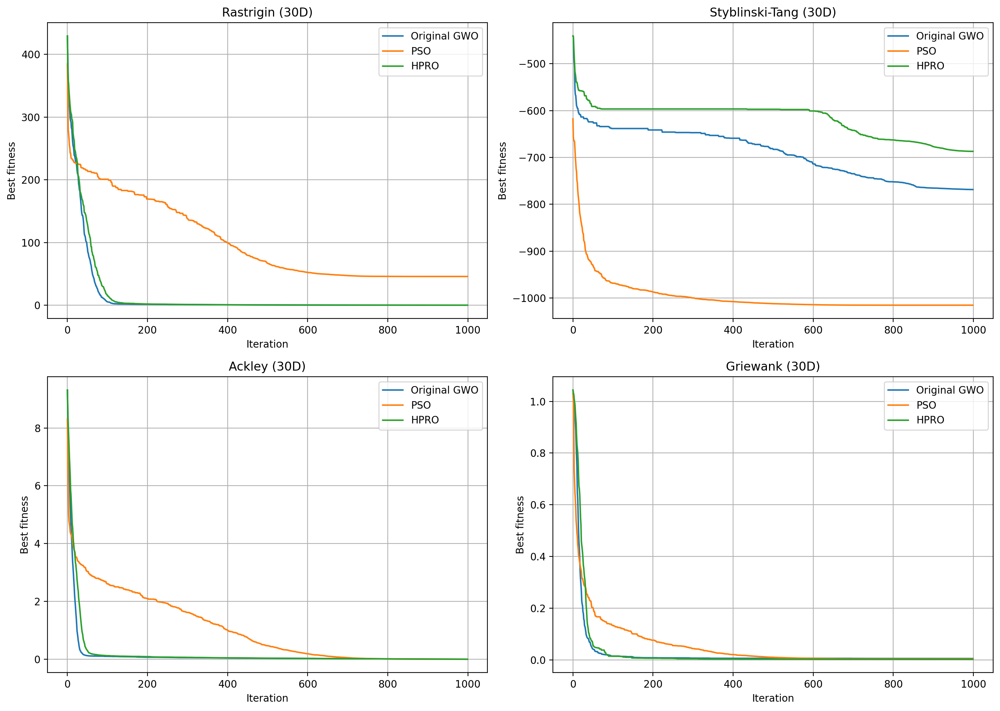

# HPRO — A Grey Wolf Optimizer Variant with Group Leadership and Population Regeneration

**Soft Computing 作業二（3 人團隊）｜NTUST 工業管理所**

以灰狼演算法（GWO）為基礎設計新的群體最佳化演算法 HPRO（Hierarchical Pack Regeneration Optimizer）：把固定的 α、β、δ 領頭狼改成「分組領導」，並讓長期停滯的個體用 Lévy flight 重生。我們和原始 GWO、PSO 在 4 個測試函數 × 3 種維度 × 每組 10 次獨立執行下比較，並做消融實驗（ablation）拆解每個改動的貢獻。

HPRO 在 **Griewank 函數 30 維與 50 維取得三者最好的平均值**（50 維平均 4.1×10⁻⁷，成功率 100%；原始 GWO 為 6.0×10⁻³、80%）。但在 Rastrigin、Ackley 上精度不如原始 GWO。結果顯示重生機制有助於跳出多峰函數的局部解，代價是收斂精度。



---

## What HPRO changes

HPRO keeps GWO's encircling-and-hunting update but changes who the pack follows and what happens to agents that stop improving.

| Component | Original GWO | HPRO |
|---|---|---|
| Leaders | The three best wolves (α, β, δ) | α is the current best; β and δ are sampled from ranked leader groups of size ⌈0.1 N⌉ |
| Stagnating agents | Keep updating like everyone else | After 30% of the iterations, an agent that stays in the ω group for ⌈0.05 T⌉ iterations is removed |
| Replacement | — | A new agent is generated around a roulette-selected leader with a Lévy-flight step |

The goal is to keep diversity in the population late in the search, when standard GWO tends to collapse onto its three leaders.

## Experimental setup

| Setting | Value |
|---|---|
| Algorithms | HPRO, original GWO, PSO |
| Benchmark functions | Rastrigin, Styblinski–Tang, Ackley, Griewank |
| Dimensions | 10, 30, 50 |
| Population / iterations | 30 / 1000 |
| Independent runs | 10 per case (seed = 42 + run) |
| Search bounds | [−5, 5] |
| PSO | inertia 0.9 → 0.4, c₁ = c₂ = 2.0, v_max = 1.0 |
| Success criterion | Rastrigin ≤ 0.01·D; Ackley, Griewank ≤ 0.01; Styblinski–Tang within 0.5·D of the optimum |

## Results

### 30 dimensions — mean best value over 10 runs (success rate)

| Function | Original GWO | PSO | HPRO |
|---|---:|---:|---:|
| Rastrigin | **1.66e-05** (100%) | 45.8 (0%) | 7.10e-05 (100%) |
| Styblinski–Tang | −768.5 (0%) | **−1015.2** (0%) | −687.0 (0%) |
| Ackley | **2.09e-04** (100%) | 2.44e-04 (100%) | 4.96e-04 (100%) |
| Griewank | 5.28e-03 (90%) | 4.10e-03 (90%) | **2.41e-03** (80%) |

Lower is better for every function. The Styblinski–Tang optimum at 30 D is about −1175.

### Which algorithm had the best mean, across all 12 cases (4 functions × 3 dimensions)

| Original GWO | PSO | HPRO |
|---:|---:|---:|
| 7 | 3 | 2 (Griewank 30 D and 50 D) |

The full table for 10, 30 and 50 dimensions is in `assets/standard_algorithm_comparison_results.csv`.

### Ablation (30 dimensions, mean / success rate %)

| Variant | Rastrigin | Styblinski–Tang | Ackley | Griewank |
|---|---|---|---|---|
| Original GWO | 0.000017 / 100 | −795.742 / 0 | 0.000238 / 100 | 0.000980 / 100 |
| Group leadership only | 0.000097 / 100 | −587.258 / 0 | 0.000440 / 100 | 0.000000 / 100 |
| Birth–death only | 0.000014 / 100 | −853.620 / 0 | 0.000217 / 100 | 0.001221 / 90 |
| HPRO (both) | 0.000075 / 100 | −623.297 / 0 | 0.000413 / 100 | 0.000000 / 100 |

(The ablation notebooks use their own runs, so the GWO row differs slightly from the comparison table above.)

**Reading the ablation:** group leadership is what drives the Griewank improvement but slows convergence on Rastrigin and Ackley; birth–death regeneration on its own is the strongest variant on Rastrigin, Ackley and Styblinski–Tang. Combining both inherits the Griewank gain and part of the precision loss. A natural next step is to adapt the leader-group size over time instead of fixing it at 10% of the population.

## Repository structure

| File / folder | Purpose |
|---|---|
| `run_standard_comparison.py` | Reproducible script: HPRO vs. original GWO vs. PSO on all functions and dimensions |
| `GWO_hybrid0.3.ipynb` | Final HPRO notebook |
| `GWO_original.ipynb` | Original GWO baseline |
| `GWO_group.ipynb` | Ablation: group leadership only |
| `GWO_borndeath.ipynb` | Ablation: birth–death regeneration only |
| `GWO_hybrid.ipynb` | Earlier hybrid draft |
| `assets/` | Result tables, convergence plots and report-ready LaTeX tables |
| `Soft_computing A2.pdf` | Presentation slides |

## How to run

```bash
pip install -r requirements.txt
python run_standard_comparison.py
```

The script regenerates the comparison tables and convergence plots in `assets/`.

## Team

林冠廷（M11401023）、陳喻宣（M11401102）、溫翎傑（M11401204）
